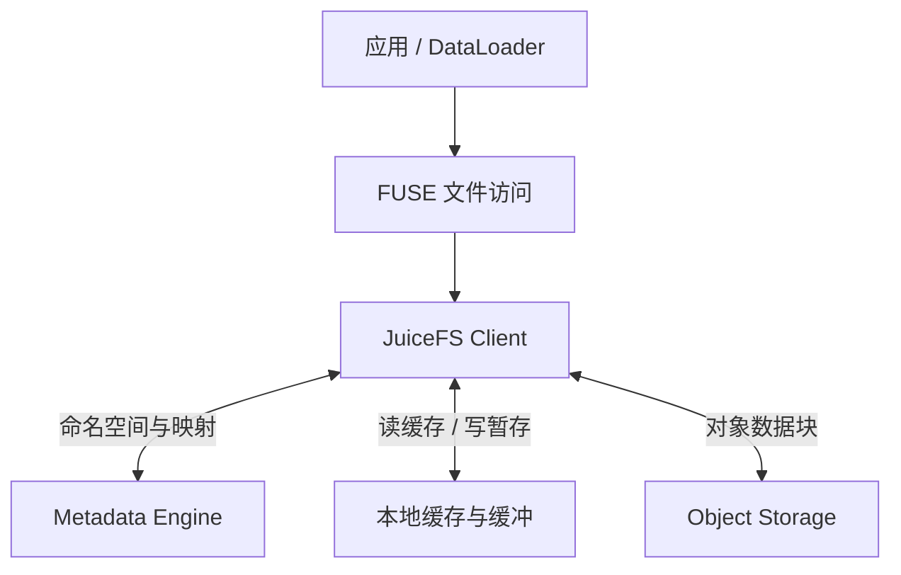

# JuiceFS：文件语义、独立元数据与对象后端的组合

## 页面定位与资料范围

前面的 [Ceph RGW](02-ceph-rgw.md)、[MinIO](03-minio.md) 和 [Swift](04-openstack-swift.md)以对象服务为比较单位。本篇沿用 [Comparison Framework](01-comparison-framework.md)，检查另一种组合：应用需要文件路径与共享目录，长期容量来自对象存储，中间由谁承担文件语义、缓存和恢复责任？

**核对日期：2026-10-21（Asia/Shanghai）。** 社区版发布基准为 [v1.4.1](https://github.com/juicedata/juicefs/releases/tag/v1.4.1)（2026-07-30）。行为依据是下列官方滚动文档，不能把滚动页面所有能力无条件绑定到该 tag。企业版 / 云服务与 CSI 文档分别限定范围；不提供部署命令，不声称完成本站性能或故障实验。

## 1. System Position

[社区版架构](https://juicefs.com/docs/community/architecture/)将系统分为 Client、Metadata Engine 和 Data Storage。客户端协调文件 I/O；数据库保存命名空间及数据映射；对象后端保存数据块。客户端访问两种后端，文件正文不必经元数据数据库转发。

图示为 FUSE 路径的逻辑职责，不代表每次读取都访问全部组件。**工程分析：**文件接口的兼容性降低应用适配成本，但额外引入元数据、客户端资源及缓存管理，不能从后端 S3 的单独能力推断整体服务表现。

## 2. Access Model

社区版提供 FUSE 等入口；[CSI Driver](https://juicefs.com/docs/csi/introduction/)将 JuiceFS 接入 Kubernetes 的 PV / PVC。在其默认 Mount Pod 模式中，实际挂载由运行 JuiceFS Client 的 Mount Pod 承担。CSI 的卷提供与挂载控制，和运行时文件 I/O 是两条职责。

文件路径也不是后端 Bucket Key 的简单别名。应用写入的原始文件会被转换为内部块，不能把后端 Bucket 当作同一套普通文件直接编辑。这里区别于“将现有任意 S3 对象按路径呈现”的访问需求；若使用导入或其他接口，要另查其转换契约。

**AI 场景推导：**已有训练代码依赖 open、seek、目录和权限时，可以评估文件访问；能直接消费对象 shard 的程序也可以使用对象 SDK。比较时同时计入应用适配、读取放大、CPU 和运维成本，不预设挂载一定更快。参照 [Training Data Path](../12-ai-storage-connections/02-training-data-path.md)。

## 3. Metadata

[Metadata Engine 文档](https://juicefs.com/docs/community/databases_for_metadata/)涵盖多种数据库选择。不能把社区版统一描述为“Redis 单点”，也不能从支持某数据库推断所有部署具有相同 HA、持久化或扩展能力。[Redis 实践文档](https://juicefs.com/docs/community/redis_best_practices/)明确提示异步复制故障切换可能丢失已确认修改，Redis Cluster 的同文件系统元数据也不能简单理解为随意跨分片事务。

**通用映射：**目录 / inode / 数据映射是文件恢复材料，不是丢了以后扫描对象名称就必然能恢复的加速索引。容量、授权和可用性需分别预算；数据正文仍在，并不意味着文件系统可以正常解释它。复用 [Metadata / Object Index](../08-consistency-metadata-partitioning/02-metadata-object-index.md)。

## 4. Partition / Placement

官方架构及 [I/O Workflow](https://juicefs.com/docs/community/internals/io_processing/)区分三层：Chunk 是按文件 offset 定位的逻辑范围（64 MiB）；Slice 表达写入片段；Block 是最终对象 / 磁盘缓存单元（默认最大 4 MiB）。这些不是三份冗余，也不对应模型 Tensor Shard 或对象后端的 EC Fragment。

**示意：**文件某范围再次写入，可以产生新片段与块，读取时按有效映射组合内容；不能按后端对象数量判断逻辑文件数。由此分析随机覆盖时，应分别量化片段、对象请求和逻辑有效字节，而不把每次小写都假设为完整大块原地改写。

## 5. Data Protection

对本篇社区版组合架构，分别核对数据库与对象后端的保护承诺；本地读缓存不替代任一后端。不能把 MinIO 的 EC、某云 Bucket 的跨区复制或数据库的持久配置统称为 JuiceFS 自动提供的同一种保护。

**通用恢复集合：**文件系统配置与必要密钥、相容元数据、被引用的数据块共同决定恢复能力。若元数据备份引用的块已经被清理，只有目录记录也不够；若块尚在但映射不可用，也不能直接恢复全部文件。数据保留与元数据备份必须联合制定，连接 [Backup / Restore](../07-data-protection/07-backup-restore.md) 和 [Failure Domain](../07-data-protection/03-failure-domain-placement.md)。

## 6. Read Path

依据 [I/O Workflow](https://juicefs.com/docs/community/internals/io_processing/)，客户端可读取对象全部内容或所需范围，预取可额外填充本地块缓存。下列是分析职责，不要求串行独立 RPC：**解析路径与权限 → 获取有效映射 → 检查数据缓存 → 读取缺失块 / 范围 → 组合返回文件字节**。

**工程分析：**缓存热时可能主要消耗本地磁盘或内存，冷时才暴露对象延迟和请求率；有缓存不代表无需元数据。大量小文件可以同时产生 open / lookup 和对象 GET 压力，不能宣称文件层自动消除了小对象固定成本。

对于稀疏随机读取，预取整个块可能多读无用数据；连续读取或后续重复访问时才可能摊销。应同时看有效样本字节、后端下载字节和缓存写入量，复用 [Cache / Prefetch](../09-data-path-performance/04-cache-prefetch.md)。

## 7. Write Path

I/O Workflow 描述默认路径：write 先进入客户端缓冲，flush 将片段上传为对象块，上传成功后更新对应元数据。应用的 close / fsync 可触发刷新。**write 返回、写入客户端可见、后端上传和文件状态提交不是同一事件。** 对象上传成功后、元数据提交前发生失败，应按可判定状态重试与清理，不能从已有对象倒推出完整文件已提交。

同一文档明确：启用客户端 `--writeback` 后，flush 可以在写入本地缓存目录后返回，正文随后异步上传。这个选项与 FUSE 内核 `writeback_cache` 是不同机制，不可仅凭名称混用。

| 场景 | 需要区分的恢复边界 |
| --- | --- |
| 默认路径的 write 已返回，flush 未成功 | 缓冲状态不等于可恢复文件；应用必须处理后续错误 |
| 客户端 writeback 的 flush 已返回 | 不能推断对象上传完成；本地暂存故障域进入恢复条件 |
| 文件已按所选配置提交 | 仍需数据库 / 对象后端自身保护满足目标 |
| 所有 checkpoint shard 可读 | 仍需应用确认完整、相容的训练恢复点并发布 |

最后一行是通用应用协议，不声称 JuiceFS 自动提供跨文件 Checkpoint 事务。**Checkpoint 分析示意：**如果最新恢复点只依赖单节点 writeback 暂存，删除训练节点前必须另证所需远端完成；不能用“close 没报错”推断能抗节点丢失。衔接 [Model Weights / Checkpoints](../12-ai-storage-connections/03-model-weights-checkpoints.md)。

## 8. Consistency Boundary

[POSIX Compatibility](https://juicefs.com/docs/community/posix_compatibility/)说明 close-to-open 及原子元数据操作等行为；[Cache 文档](https://juicefs.com/docs/community/guide/cache/)进一步说明缓存条件和例外，例如启用 `--open-cache` 会改变跨客户端观察。应按接口、mount 配置、打开方式和操作类型记录保证，不能仅以“POSIX 兼容”推出所有并发行为。

**通用并发示意：**A 改写并关闭文件，B 已长期打开旧句柄，与 B 重新打开、B 在更激进元数据缓存下重新访问，是不同测试条件。另测删除后同名重建，避免把路径字符串相同误认成 inode 身份相同。

原子 rename 也不自动将多个文件的内容持久化、建立集群快照或证明所有 checkpoint shard 属于同一步训练；存储命名空间操作和应用发布边界需分开验证。

## 9. Failure Recovery

[Metadata Backup & Recovery](https://juicefs.com/docs/community/metadata_dump_load/)描述 dump / load 与自动备份，同时明确 dump 不提供快照一致性。自动备份也有执行条件，不能只因默认启用就认为存在最新可用备份。恢复应结合数据库原生备份，并实际验证材料与业务目标。

下面是**通用故障判断表**，不是已执行实验或对所有操作的可用性承诺：

| 故障 | 先判定什么 | 恢复与验证 |
| --- | --- | --- |
| 只读缓存设备丢失 | 后端数据和映射是否有效 | 可评估重读 / 预热；测量回源冲击 |
| 尚未上传的写暂存丢失 | 哪些修改只有本地材料 | 不能按普通读缓存丢失处理；核对缺失写入 |
| Metadata Engine 不可达 | 哪些操作仍依赖服务，缓存可覆盖多少 | 验证切换、客户端重连及实际读写结果 |
| 元数据回滚到备份 | 备份时点、完整性和引用块是否存活 | 隔离恢复后验证目录、文件内容和进度缺口 |
| 对象块不可读 | 后端故障、权限、网络还是永久丢失 | 沿后端保护机制恢复，不能靠元数据造回正文 |
| 计算节点扩容 | 缓存和挂载是否随新节点冷启动 | 控制并发回源，确认训练实际恢复供给 |

恢复元数据前应确认备份代表什么时点，旧备份引用是否仍满足对象保留；故障期间不应盲目清理“看似孤立”的块。复用 [Disaster Recovery](../10-recovery-operations-observability/11-disaster-recovery-rpo-rto.md) 和 [Failure Drill](../10-recovery-operations-observability/12-failure-drill.md)。

## 10. Rebalance / Expansion

增加计算节点、扩展元数据能力、扩容对象后端、重新分布缓存是不同动作。**工程分析：**增加 Client 可以扩大访问并发，也可能放大数据库请求和重复下载；它不代表原有对象正文被 JuiceFS 重新平衡。后端如何扩容仍回到所选系统案例。

**企业版对照：**[分布式缓存文档](https://juicefs.com/docs/cloud/guide/distributed-cache/)描述缓存组共享块、成员变更与回源；这些不作为社区版能力。共享缓存故障后回源可以维持部分访问，但会放大对象后端压力；缓存扩容和持久数据扩容也有不同完成条件。

## 11. Integrity

[Status Check & Maintenance](https://juicefs.com/docs/community/administration/status_check_and_maintenance/)提供 fsck、gc 等维护入口。可查引用、可查缺块与可证明业务内容正确不是同一覆盖范围；不把任一工具名称解释为“自动修复全部损坏”。

**通用验证分层：**文件身份与映射有效性、引用块存在性、传输 / 缓存校验、最终应用内容验证分别记录。元数据事务不能排除设备损坏，后端对象冗余也不能证明 DataLoader 读取的是目标 Dataset 版本。GC、Trash 与 Compaction 是生命周期操作，不替代独立备份；其读取、重写和清理还会争用前台资源。

## 12. Operations / Observability

[JuiceFS Metrics](https://juicefs.com/docs/community/reference/p8s_metrics/)为文件访问、元数据和对象交互提供观察入口。下面是要关联的指标类别，不将逻辑名称伪装为固定版本的 Prometheus 指标名：

| 层次 | 应关联的证据 |
| --- | --- |
| 应用 | DataLoader 等待、batch-ready、有效 samples/s、step time |
| 挂载与 Client | 文件操作延迟、错误、CPU、缓冲、连接和会话状态 |
| 元数据 | 操作率 / 尾延迟、数据库容量、持久化和切换状态 |
| 缓存与对象 | 分层命中、回源字节、GET / PUT、重试、上传积压 |
| 恢复材料 | 最近成功备份、实际可恢复范围、引用数据保留和密钥可用性 |

**Kubernetes 分析：**Pod 已 Running 或 PVC 已 Bound 不证明挂载能稳定供给数据。还要看 Mount Pod / Client 的资源、节点缓存盘生命周期以及节点迁移后的冷读；CSI 控制面健康不能代替运行时文件请求结果。

## 13. Performance Implications

JuiceFS 对 AI Infra 的研究价值在于把文件接口、共享数据集、独立元数据和对象容量连接起来；本篇不声称其市场占有率，也不引用缺少可比条件的倍数性能排名。

**建议验证矩阵（非本站跑分）：**

| 工作负载 | 固定条件 | 主要判断 |
| --- | --- | --- |
| 小文件随机样本 | Dataset / Manifest、大小分布、Worker 数 | open / lookup、对象请求率和 batch 等待 |
| 大 shard 顺序 / 稀疏读取 | 样本选择、索引、解压方式 | 预取有用量、读取放大和 CPU 限制 |
| 多 Rank 重复读取 | 缓存模式、容量、节点分布 | 命中收益、重复回源、共享链路竞争 |
| 权重集中加载 | 模型版本、并发扩容数量 | 源端压力与实例真正 Ready 时间 |
| Checkpoint 保存 / Restore | writeback 配置、提交与保护目标 | 暂停、远端完成滞后、恢复时间和进度损失 |
| 节点退出 / 缓存变冷 | 故障范围、限流与恢复材料 | 回源尖峰、服务退化和恢复收敛 |

对直接对象 SDK 与文件访问做比较时，保留相同有效数据、缓存预算和完成语义。冷读与暖读分开，训练数据与 Checkpoint 同时运行时再测共享干扰；不能用 Page Cache 吞吐代表对象后端能力。普通挂载路径也不自动等于 GDS、GPU Direct 或专用 KV Cache 服务。

## 14. Mapping Back to Generic Model

| JuiceFS 观察对象 | 通用模型 | 对应边界 |
| --- | --- | --- |
| 文件路径与 inode | Namespace / Logical Identity | 不是后端对象 Key 的同义词 |
| Chunk / Slice / Block | 寻址、写入映射与物理单元 | 不等于保护组或训练 shard |
| 独立数据库 | Metadata Authority | HA、持久化与数据正文保护分开 |
| 默认刷新与客户端 writeback | 准备、发布与故障域 | 返回成功需绑定具体配置和完成层 |
| 读缓存与回源 | Cache / Prefetch / Backpressure | 暖读收益与冷启动负载一起衡量 |
| dump / load 与数据块保留 | Backup / Restore | 导出成功不代表一致恢复点可用 |

对象服务三系统的 [综合比较](05-object-storage-cross-system-comparison.md)仍以对象接口为范围；JuiceFS 是文件语义建立在对象后端之上的补充案例，不作为第四个 S3 服务硬加入同一排名。

## 官方资料与核对记录

核对日期统一为 **2026-10-21**。发布基准与滚动资料分开，文中的故障表、AI 场景、测量矩阵及通用映射是工程分析。

- [社区版 v1.4.1 Release](https://github.com/juicedata/juicefs/releases/tag/v1.4.1)：发布范围基准；不据此保证滚动文档每项行为均属于此版本。
- [Architecture](https://juicefs.com/docs/community/architecture/) / [Metadata Engine](https://juicefs.com/docs/community/databases_for_metadata/)：组件、逻辑单元和数据库选择。
- [I/O Workflow](https://juicefs.com/docs/community/internals/io_processing/)：读写、缓冲、刷新与 writeback；[Cache](https://juicefs.com/docs/community/guide/cache/) / [POSIX Compatibility](https://juicefs.com/docs/community/posix_compatibility/)：缓存配置与观察语义。
- [Redis Best Practices](https://juicefs.com/docs/community/redis_best_practices/)：该后端的 HA 和持久性边界；不推广为全部元数据引擎的保证。
- [Metadata Backup & Recovery](https://juicefs.com/docs/community/metadata_dump_load/)：备份 / 导入及一致性限制；[Maintenance](https://juicefs.com/docs/community/administration/status_check_and_maintenance/) / [Metrics](https://juicefs.com/docs/community/reference/p8s_metrics/)：工具与观测入口。
- [企业版 / 云服务 Distributed Cache](https://juicefs.com/docs/cloud/guide/distributed-cache/)：仅用于版本边界对照；[CSI Introduction](https://juicefs.com/docs/csi/introduction/)为独立驱动资料，不绑定社区版 Client tag。

[典型系统目录](README.md) · [文件存储入口](../05-file-storage/README.md) · [AI 数据路径](../12-ai-storage-connections/02-training-data-path.md)
